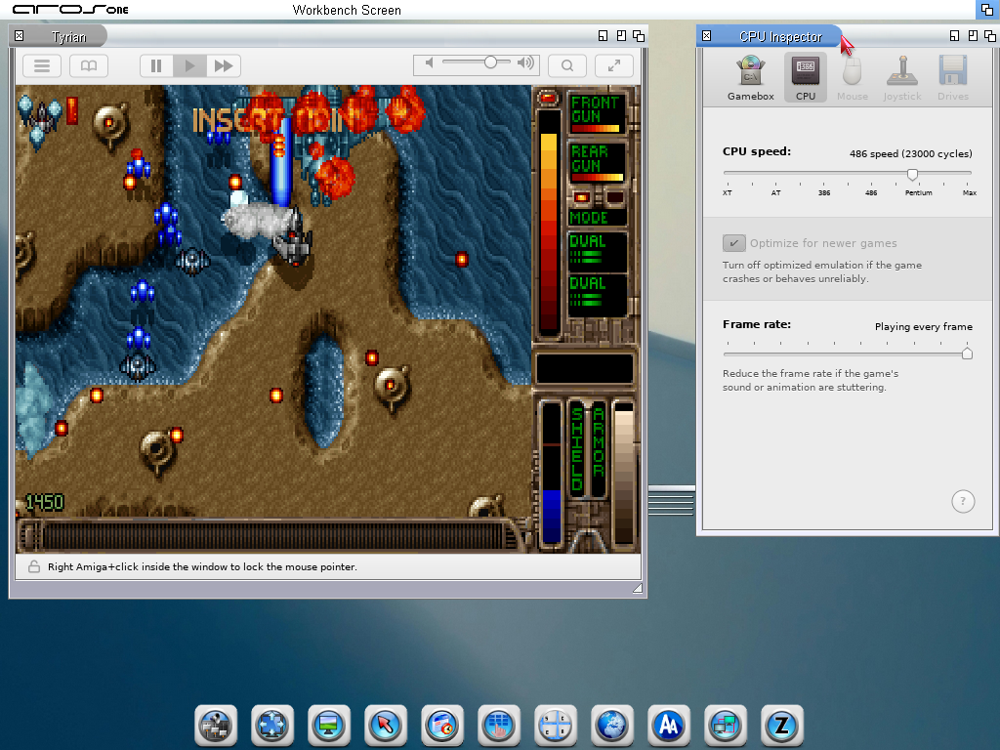

# Boxer for AROS


An AROS port of [Boxer](https://github.com/alinebee/Boxer), the DOS game
emulator front end by Alun Bestor, with Boxer's own DOSBox 0.74 core.

It brings Boxer's gamebox workflow and interface to AROS using Zune.
**This is an experimental preview.** It provides the foundation for the
port; it is not yet the complete Boxer experience.

[](documentation/screenshots.md)

[See the screenshot gallery](documentation/screenshots.md): Welcome, import, covers, games folder, recent games, gameplay, DOS prompt, program launcher and Inspector. Captured with Boxer 0.2.0-preview1 on AROS One (x86_64 ABIv11).

## What this preview can do

- Import a game folder: run its installer or copy a ready-to-play game,
  then choose its startup program. Choose the folder in a requester, or
  drop its icon from Wanderer on "Import a new game" or on the Import
  window. One folder at a time; disks, disc images and files are refused
  with a message.
- Drop a gamebox's icon on "Import a new game" or "Open a DOS prompt" to
  play it in a new Boxer window.
- Give the game a name and a cover. As in Boxer, the cover is a CD case or
  a 3.5" or 5.25" diskette labelled with the game's name, or a picture of
  your own. The game's icon in your games folder shows the cover. You can
  rename the game and change its cover later in the Inspector.
- Launch the game from its icon, play, save using the game's own save
  system, close the session, and reopen the game to continue. Saved games
  and other changes made during play are stored separately in
  **Boxer Data**, so the imported gamebox stays unchanged.
- Open your games folder from the Welcome window with "Browse your games".
  If the folder has been moved or renamed, Boxer helps you find it and its
  saved games again.
- Reopen one of the last ten games with "Open recent" in the Welcome
  window or File > Open Recent. If a game has been moved, Boxer asks you
  where it is now. File > Open... opens any gamebox.

No games are included; bring your own DOS games.

## Supported system

- **AROS One (x86_64 ABIv11):** tested under QEMU.
- **Mainline AROS (x86_64 ABI v1):** partly tested under QEMU; see
  Limitations.
- **Raspberry Pi (AArch64, AROS for Raspberry Pi):** experimental, tried
  only under QEMU, without real sound output; see Limitations.
- Other distributions and real hardware have not been tested.

ABIv11, mainline and Raspberry Pi binaries are different files, each in its
own archive, and do not run on each other.

## Download

Get the archive from the
[releases page](https://github.com/tomaszstaniak/aros-boxerapp/releases)
(currently [0.2.0 preview 1](https://github.com/tomaszstaniak/aros-boxerapp/releases/tag/v0.2.0-preview1),
for x86_64 ABIv11, x86_64 mainline AROS and Raspberry Pi, all experimental).
Checksums are listed with each release.

## Limitations

**Use a separate test installation or a copy of your AROS system.**

- A game session can freeze, including when you leave a game's installer.
  Closing a session that has stopped responding can crash AROS. Save your
  work in other programs before you test.
- Automatic CPU speed can drop very low, for example after a game is
  reopened: a game may then seem to stop while loading, and may not find
  its sound card. Set a fixed CPU speed (for example Pentium) for that game
  in the Inspector and reopen it; the speed and frameskip chosen there are
  kept for that game.
- Mainline AROS: under QEMU we saw games and their sound slow down
  seriously when the host ran QEMU at low (background) priority; at normal
  priority the tested game ran at full speed. A fixed CPU speed does not
  fully remove the slowdown. Physical hardware has not been tested.
- Raspberry Pi: tried only under QEMU, without real sound output; sound and
  speed on a real Raspberry Pi are untested. DOS programs run on DOSBox's
  interpreter core only. Boxer can crash while you choose the folder of a
  game to import.
- Tested only under QEMU. Game compatibility is not yet broadly tested.
- Unfinished: the games folder opens in Wanderer as a normal drawer, without
  Boxer's wooden shelf look, and the cover labels use the system's Vera Sans
  instead of Boxer's own font.

## Install

1. Unpack the archive for your system, for example to `SYS:` or `Work:`.
   With the `.zip`, on a system that has UnZip (AROS One does):
   `UnZip Boxer-<version>-aros-x86_64-abiv11-pc.zip -d Work:`.
   With the mainline `.pkg`, on any mainline system:
   `Unpack Boxer-<version>-aros-x86_64-abiv1-pc.pkg TO Work:`.
   On the Raspberry Pi, which has no UnZip:
   `Unpack Boxer-<version>-aros-aarch64-abiv1-raspi.pkg TO Work:`.
   This makes the drawer `Boxer`.
2. Open the drawer and double-click `Install-Assign`. It assigns `Boxer:`
   to the drawer and adds a marked block to `S:User-Startup` so the assign
   is set at every boot. Game icons need `Boxer:`.
3. Double-click `BoxerUI`. On the first start it proposes a folder for your
   games and one for their saved games. From a Shell, use `Stack 65536`
   first.

`ReadMe.txt` in the drawer has the details.

## Uninstall

In a Shell, `CD` to the Boxer drawer and run `Execute Install-Assign
REMOVE`, then delete the lines from `;BEGIN Boxer` to `;END Boxer` in
`S:User-Startup` if you want them gone, and delete the drawer. Your games
folder, its `Boxer Data` (saved games) and `ENVARC:Boxer` are separate;
delete them only if you no longer want them.

## Logs

Each BoxerUI process writes its own log, by default a new file in
`RAM:BoxerLogs/` (`boxerui-1.log`, `boxerui-2.log`, ...; a game started
from its icon or by a drop is a process of its own). The first line of a
log names its file. RAM: is lost when AROS restarts or crashes. To keep the
log, start BoxerUI with a log in a writable drawer, for example the ToolType
`LOG=Work:boxerui.log` or, from a Shell, `BoxerUI LOG Work:boxerui.log`
(the Boxer drawer itself may be read-only). While that file is open in one
BoxerUI, another one logs to a numbered file beside it.

Problems can be reported through the
[issue tracker](https://github.com/tomaszstaniak/aros-boxerapp/issues).

## Building from source

The build runs on a macOS host with an AROS cross toolchain (GCC 10.5 for
x86_64, Clang 20.1 for the Raspberry Pi) and SDK for each ABI. In short:

```sh
cp local.env.example local.env     # fill in toolchain and SDK paths
scripts/bootstrap.sh               # fetch Boxer at the pinned commit, apply patches/boxer
scripts/build-sdl3.sh abiv11
scripts/build-core.sh abiv11
scripts/build-ui.sh abiv11
scripts/make-package.sh abiv11
```

Source pins, requirements, variables and tests:
[documentation/development.md](documentation/development.md).
Patch workflow: [documentation/patching.md](documentation/patching.md).

## Licence and credits

Distributed under the GNU General Public License version 2 (`COPYING`).
Code written for this port is GPL-2.0-or-later; files derived from Boxer are
GPL-2.0-only; files derived from ADBToolkit are BSD-2-Clause. Each file
carries an SPDX header. All components, authors and licence texts are listed
in [documentation/licenses.md](documentation/licenses.md) and `LICENSES/`.

- **Boxer** is copyright (c) 2013 Alun Bestor and contributors, released
  under the GNU General Public License 2.0. This port follows Boxer's
  behaviour, file formats and DOSBox integration, and uses Boxer's artwork
  (`assets/NOTICE-boxer.txt`).
- **DOSBox** 0.74 is copyright (C) 2002-2010 The DOSBox Team, GPL version 2
  or later.
- **SDL** is by Sam Lantinga and SDL contributors (zlib); the AROS SDL3 port
  is by the AROS contributors.
- **GNU libiconv** (LGPL-2.1-or-later) is linked into the x86_64 programs.
  Its source as linked and a relink kit are published with each release as
  `Boxer-<version>-<target>-lgpl-kit.zip`; see
  [documentation/licenses.md](documentation/licenses.md).
- Replacement icons: Feather by Cole Bemis (MIT,
  `assets/NOTICE-replacements.txt`). Fonts: Bitstream Vera descriptions
  (`LICENSES/Bitstream-Vera.txt`).

AROS port: Tomasz Staniak.
