# Boxer on AROS

[Back to the project README](../README.md)

These screenshots show Boxer **0.2.0-preview1** on **AROS One, x86_64 ABIv11**, captured on 7 November 2026 under QEMU. Window decorations and the desktop may look different on other AROS installations.

Tyrian is shown to illustrate a game session; no games are included with Boxer. Mouse, Joystick and Drives Inspector tabs are not implemented in this preview and are disabled.

[Welcome](#welcome) · [Import a game](#import-a-game) · [Choose the startup program](#choose-the-startup-program) · [Name and cover](#name-and-cover) · [Your games in Wanderer](#your-games-in-wanderer) · [Open recent](#open-recent) · [Playing a game](#playing-a-game) · [Programs and favorites](#programs-and-favorites) · [DOS prompt](#dos-prompt) · [CPU Inspector](#cpu-inspector) · [Gamebox Inspector](#gamebox-inspector)

## Welcome

Browse your games, import a new game, or open a DOS prompt.

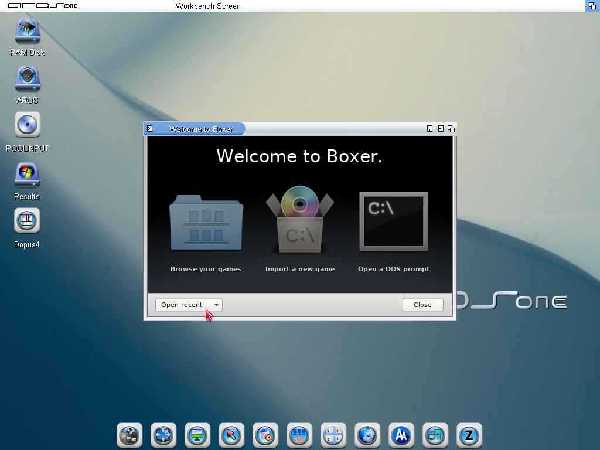

## Import a game

Choose an installer from the game folder, or skip installation for a game that is ready to play.

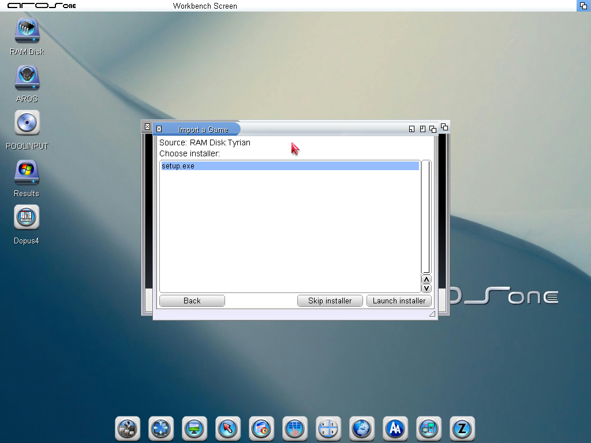

## Choose the startup program

Select the DOS program Boxer should launch when you open this gamebox.

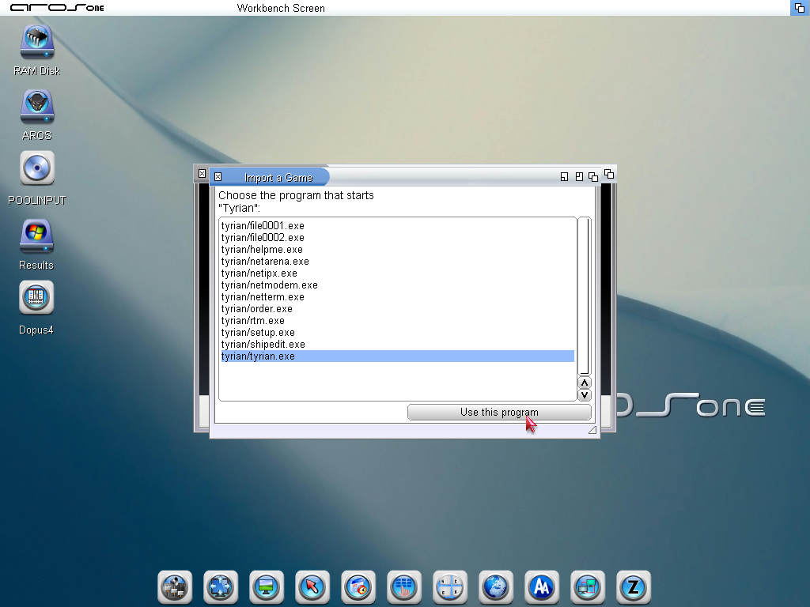

## Name and cover

Name the imported game and choose a CD case, diskette, or your own cover picture.

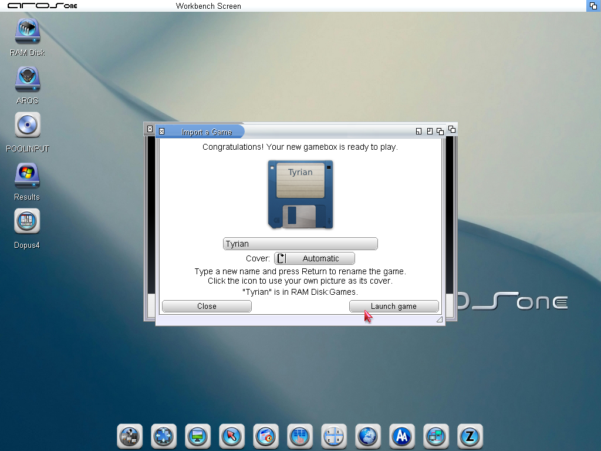

## Your games in Wanderer

Gameboxes appear in an ordinary Wanderer drawer with their cover icons. Double-click a game to open it.

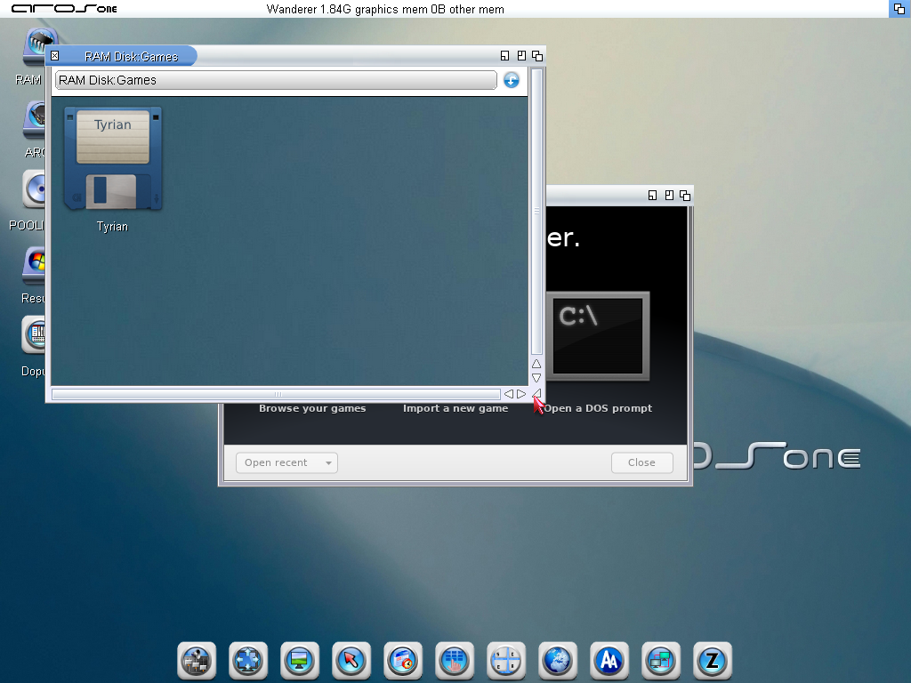

## Open recent

Reopen a game from the Welcome window. The same history is available from File > Open Recent.

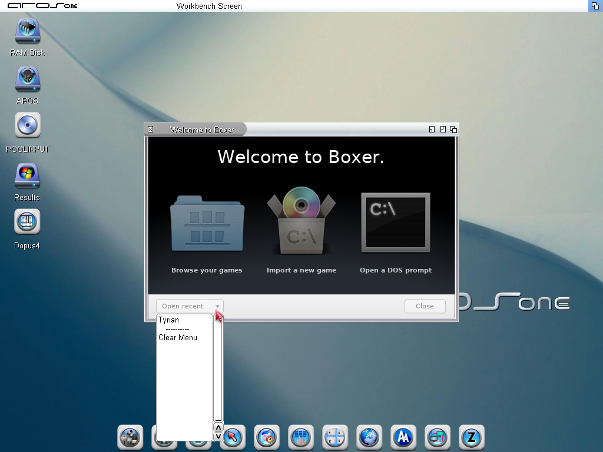

## Playing a game

Tyrian running in a Boxer window, with playback, volume, Inspector and fullscreen controls in the toolbar.

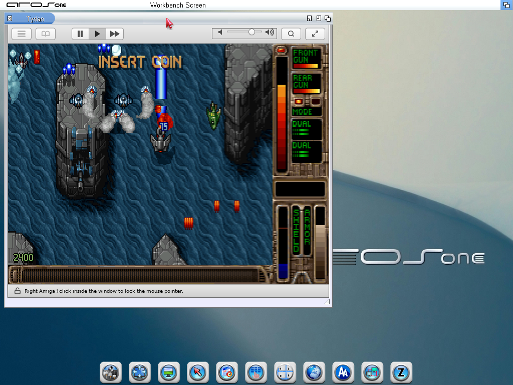

## Programs and favorites

Find programs inside a gamebox and launch them from the panel when the DOS prompt is available.

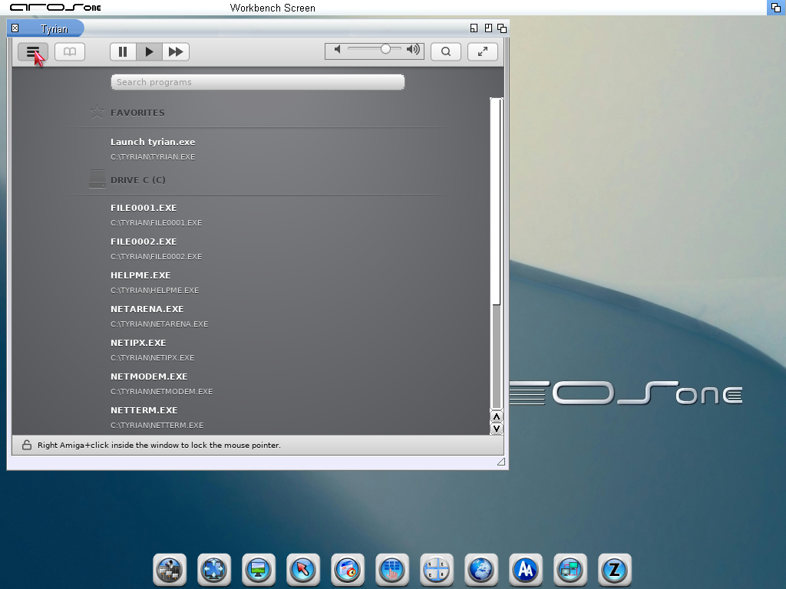

## DOS prompt

Use the DOS command line inside the game session.

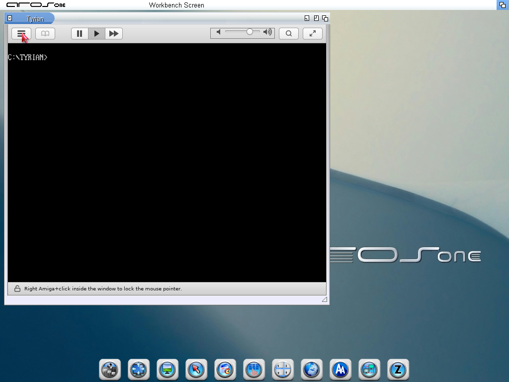

## CPU Inspector

Adjust CPU speed and frame skipping for the game. Controls that are not implemented are disabled.

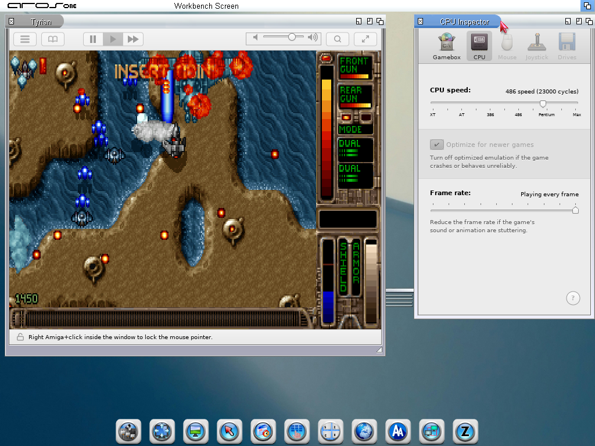

## Gamebox Inspector

Change the game name and cover. Startup and close-on-exit controls shown here are not implemented yet.

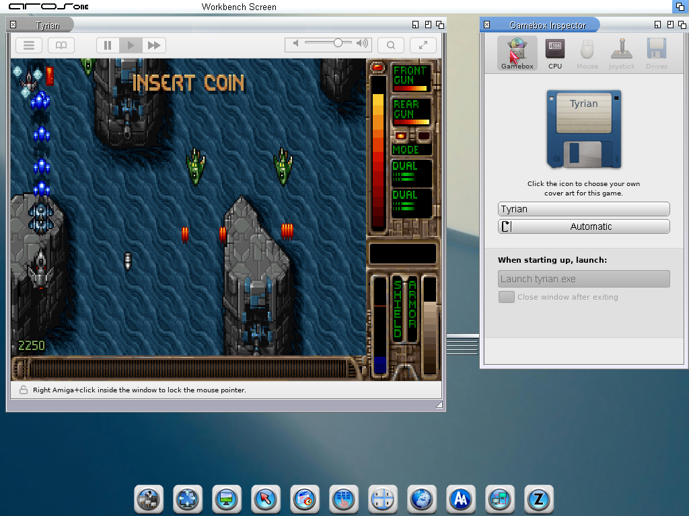

## Artwork

Boxer’s logo and interface artwork are by Alun Bestor and contributors; see the [Boxer artwork notice](../assets/NOTICE-boxer.txt). Game imagery and AROS desktop artwork belong to their respective owners. The screenshots document the running application.
